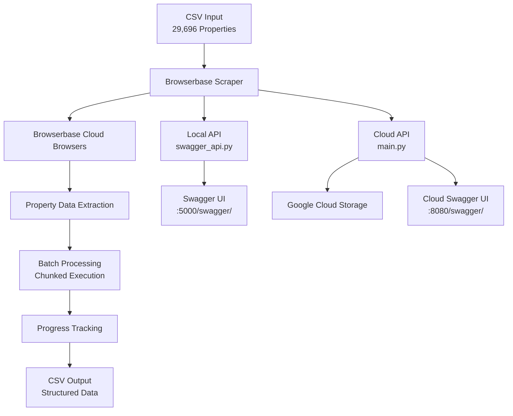

# 🏠 Browserbase Property Scraper

> **Enterprise-grade property data extraction system with cloud-native architecture**

[](./Dockerfile)
[](./deploy.sh)
[](./swagger_api.py)
[](./requirements.txt)

**Automated property data extraction for insurance and real estate analysis using Browserbase cloud browsers.**

---

## 🚀 Features

### **🎯 Core Capabilities**
- **Property Data Extraction**: Owner info, addresses, roof details, and calculated roof age
- **Insurance-Ready Output**: Specifically designed for insurance risk assessment
- **Batch Processing**: Handle thousands of properties efficiently
- **Progress Tracking**: Resume from interruptions automatically
- **Error Resilience**: Continue processing even if individual properties fail

### **🔧 Technical Excellence**
- **Interactive Swagger UI**: Test and explore APIs effortlessly
- **Dual Deployment**: Local development + Cloud Run production
- **Docker Ready**: Containerized for consistent deployment
- **Real-time Monitoring**: Track progress and health status
- **Dynamic Configuration**: Auto-calculated defaults based on data size
- **Cloud Storage Integration**: GCS backup and file management

### **📊 Data Processing**
- **Input**: 29,696+ Seminole County property URLs
- **Filter**: Single-family homes (use code "0110")
- **Extract**: Property details, ownership, roof information
- **Calculate**: Roof age for insurance assessment
- **Output**: Clean CSV with structured property data

---

## ⚡ Quick Start

### **🖥️ Local Development (Recommended for Testing)**

```bash
# 1. Clone and setup
git clone <your-repo-url>
cd Scrape_Deploy
pip install -r requirements.txt

# 2. Set environment variables
export BROWSERBASE_API_KEY=your_api_key_here
export BROWSERBASE_PROJECT_ID=your_project_id_here

# 3. Start interactive API server
python swagger_api.py

# 4. Open Swagger UI
open http://localhost:5000/swagger/
```

### **☁️ Cloud Deployment (Production)**

```bash
# 1. Build and deploy to Google Cloud Run
chmod +x deploy.sh
./deploy.sh

# 2. Access your deployed API
# Swagger UI: https://your-service-url/swagger/
```

---

## 📖 API Documentation

### **🔗 Interactive Swagger UI**
- **Local**: `http://localhost:5000/swagger/`
- **Cloud**: `https://your-service-url/swagger/`

### **📡 Key Endpoints**

| Endpoint | Method | Description |
|----------|--------|-------------|
| `/api/scraper/run` | POST | Start property scraping with custom config |
| `/api/monitoring/health` | GET | System health and environment check |
| `/api/monitoring/status` | GET | Real-time processing status |
| `/api/management/files` | GET | List available result files |
| `/api/management/download/<file>` | GET | Download specific results |

### **🚀 Usage Examples**

#### **Start Scraping Properties**
```bash
curl -X POST https://your-service-url/api/scraper/run \
  -H "Content-Type: application/json" \
  -d '{
    "start_row": 0,
    "end_row": 100,
    "chunk_size": 50,
    "output_file": "my_results.csv"
  }'
```

#### **Monitor Progress**
```bash
curl https://your-service-url/api/monitoring/status
```

#### **Download Results**
```bash
curl -O https://your-service-url/api/management/download/final_results_Seminole.csv
```

---

## 🛠️ Configuration

### **Environment Variables**
```bash
# Required for all deployments
BROWSERBASE_API_KEY=your_browserbase_api_key
BROWSERBASE_PROJECT_ID=your_browserbase_project_id

# Required for Cloud Run only  
GCS_BUCKET_NAME=your_storage_bucket_name
```

### **Scraper Configuration**
```json
{
  "csv_path": "seminole_property_urls.csv",       // Input CSV file (29,696 properties)
  "start_row": 0,                                 // Starting row (auto-calculated)
  "end_row": 29695,                              // Ending row (auto-calculated)  
  "output_file": "final_results_Seminole.csv",   // Output file name
  "chunk_size": 100,                             // Properties per batch
  "progress_file": "progress.txt"                // Progress tracking file
}
```

**💡 Smart Defaults**: `start_row` and `end_row` are automatically calculated from CSV file size. Manual override available.

---

## 📁 Project Structure

```
├── 🏠 Core Application
│   ├── main.py                    # Cloud Run API (production)
│   ├── swagger_api.py             # Local development API
│   ├── browserbase_scraper.py     # Core scraper orchestration
│   ├── scrape_single_property.py  # Individual property extraction
│   └── scrape_batch.py           # Batch processing logic
│
├── 🐳 Deployment
│   ├── Dockerfile               # Container configuration
│   ├── deploy.sh                # Automated deployment script
│   ├── requirements.txt         # Python dependencies
│   └── .dockerignore           # Docker build optimization
│
├── 📊 Data
│   ├── seminole_property_urls.csv # Input: 29,696 property URLs
│   ├── final_results_Seminole.csv # Output: Processed property data
│   └── progress.txt              # Processing progress tracker
│
└── 📚 Documentation  
    ├── README.md                 # This file
    └── BROWSERBASE_DEPLOYMENT.md # Detailed deployment guide
```

---

## 🚀 Deployment Options

### **🖥️ Local Development**
- **File**: `swagger_api.py`
- **Port**: 5000
- **Features**: Interactive Swagger UI, local file storage
- **Use Case**: Development, testing, small batches

### **☁️ Google Cloud Run**  
- **File**: `main.py`
- **Port**: 8080 (configurable)
- **Features**: GCS integration, auto-scaling, production-ready
- **Use Case**: Production, large-scale processing

### **🐳 Docker**
```bash
# Build
docker build -t browserbase-scraper:v2 .

# Run locally
docker run -p 8080:8080 \
  -e BROWSERBASE_API_KEY=your_key \
  -e BROWSERBASE_PROJECT_ID=your_project_id \
  browserbase-scraper:v2

# Access: http://localhost:8080/swagger/
```

---

## 📊 Sample Output Data

The scraper extracts and structures property data for insurance analysis:

```csv
Property URL,Owner Name,Owner Address,Property Address,Use Code,Roof Material,Roof Year,Roof Age,Processing Status
https://example.com/property/123,John Doe,123 Main St,456 Oak Ave,0110,SHINGLE,2015,9,success
```

**Key Fields**:
- **Use Code**: Property type filter (0110 = Single Family)
- **Roof Age**: Calculated from roof year for insurance assessment  
- **Processing Status**: Success/failure tracking for data quality

---

## 🔧 Advanced Usage

### **Large Scale Processing**
```json
{
  "start_row": 0,
  "end_row": 5000,      // Process in chunks  
  "chunk_size": 200,    // Larger batches for efficiency
  "output_file": "batch_1_results.csv"
}
```

### **Testing & Development**
```json  
{
  "start_row": 0,
  "end_row": 10,        // Small test batch
  "chunk_size": 5,      // Small chunks for debugging
  "output_file": "test_results.csv"
}
```

### **Resume Processing**
The system automatically tracks progress and resumes from the last successfully processed row.

---

## 🛠️ Troubleshooting

### **Common Issues**

| Issue | Solution |
|-------|----------|
| API Key Error | Set `BROWSERBASE_API_KEY` environment variable |
| CSV Not Found | Ensure `seminole_property_urls.csv` is in project root |
| Port Conflicts | Use different ports or stop conflicting services |
| Memory Issues | Reduce `chunk_size` or increase Cloud Run memory |
| Timeout | Use smaller batch sizes for initial testing |

### **Getting Help**
1. Check **Swagger UI** documentation at `/swagger/`
2. Use **health endpoint** to verify configuration: `/api/monitoring/health`
3. Monitor **processing status**: `/api/monitoring/status`
4. Review **logs** for detailed error information

---

## 🏗️ Architecture



---

## 🤝 Contributing

1. **Fork** the repository
2. **Create** a feature branch (`git checkout -b feature/amazing-feature`)
3. **Commit** your changes (`git commit -m 'Add amazing feature'`)
4. **Push** to the branch (`git push origin feature/amazing-feature`)
5. **Open** a Pull Request

---

## 📄 License

This project is licensed under the MIT License - see the [LICENSE](LICENSE) file for details.

---

## 🙏 Acknowledgments

- **[Browserbase](https://browserbase.com)** - Cloud browser infrastructure
- **[Google Cloud Run](https://cloud.google.com/run)** - Serverless deployment platform
- **[Flask-RESTX](https://flask-restx.readthedocs.io/)** - API framework with Swagger UI

---

## 📞 Support

For questions, issues, or feature requests:

- 💬 **Issues**: [GitHub Issues](../../issues)
- 📧 **Email**: your-email@example.com
- 📖 **Docs**: [Deployment Guide](./BROWSERBASE_DEPLOYMENT.md)

---

<div align="center">

**⭐ Star this repo if it helped you! ⭐**

[](../../stargazers)
[](../../network/members)

</div> # Property-Scraper
